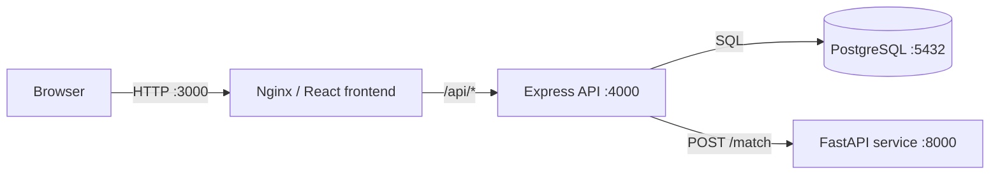
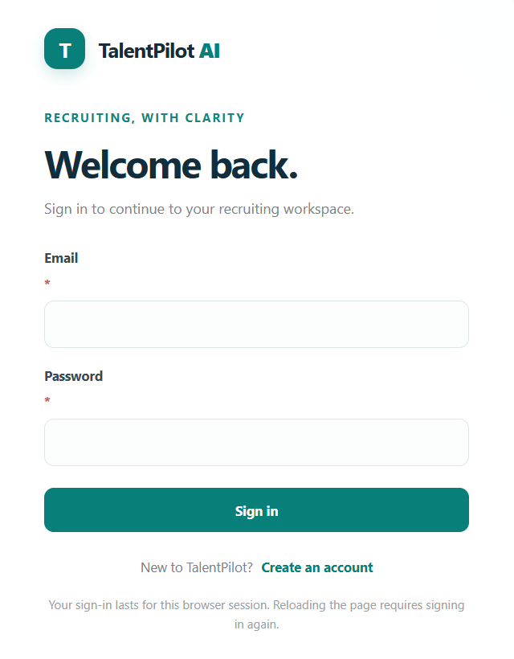
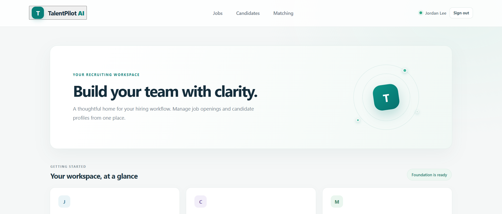
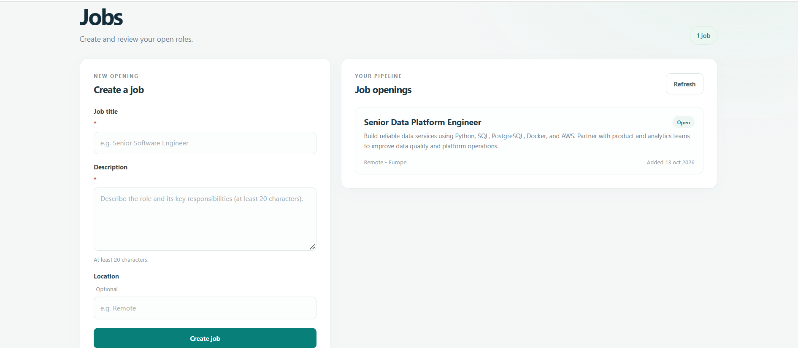
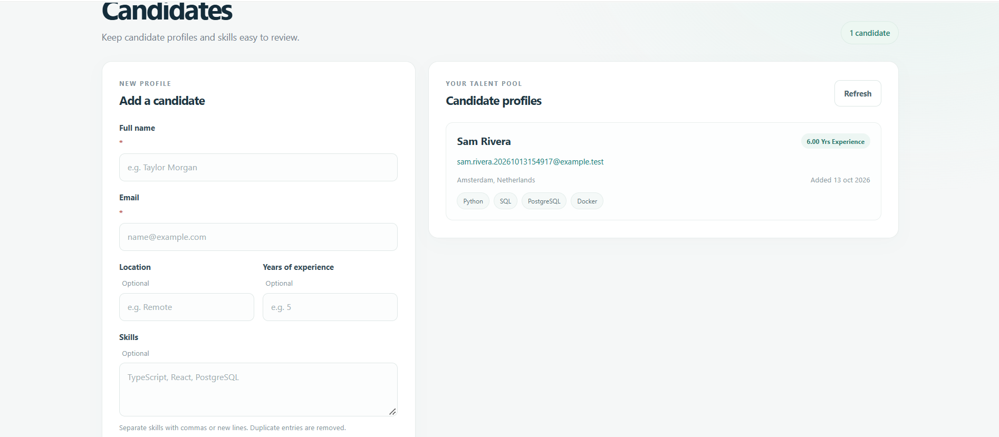
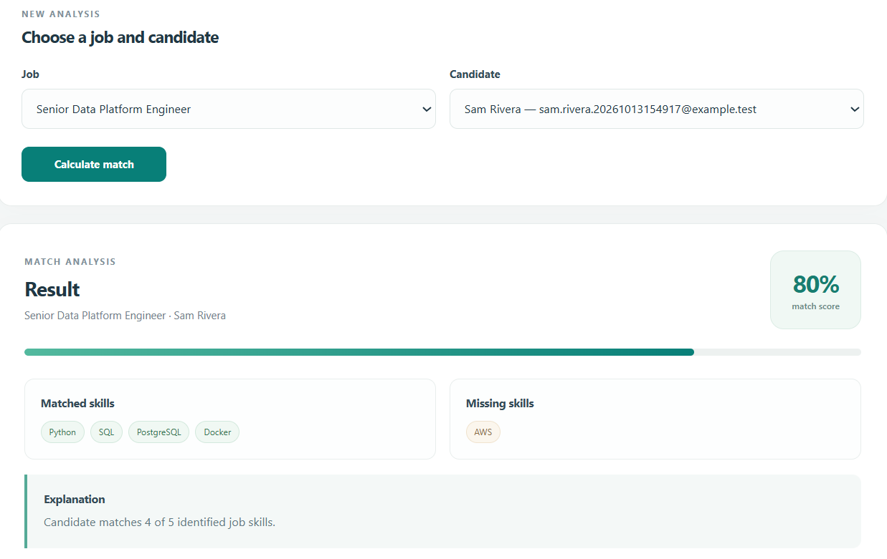

# TalentPilot AI

TalentPilot AI is a local HR Tech portfolio project for managing job openings and candidate profiles, then comparing a role's recognized skills with a candidate's recorded skills. The result shows a score, matched skills, missing skills, and a short explanation.

The project is intended to explore a practical part of recruiting workflows: making an initial skills comparison more consistent and reviewable. It supports a recruiter's assessment; it does not make hiring decisions.

## Recruitment problem

Recruiters often review candidate information from different sources and compare it with job requirements manually. That can make an initial skills review slow and inconsistent. A structured profile and a visible list of matched and missing skills provide a simple starting point for discussing fit, while keeping the comparison criteria explicit.

## Implemented features

- Recruiter account registration and login.
- Create and list job openings with title, description, and optional location.
- Create and list candidate profiles with contact details, optional experience and location, and a skills list.
- Request a job-candidate comparison and view a deterministic skills score, matched skills, missing skills, and explanation.
- FastAPI health and job-analysis endpoints.
- PostgreSQL-backed persistence, local Docker Compose services, and a browser UI served by Nginx.

The current UI does not include resume upload, candidate sourcing, advanced reporting, or application pipeline management.

## Tech stack

| Technology | Role |
| --- | --- |
| React, TypeScript, Vite | Recruiter-facing frontend and development build |
| Node.js, Express, TypeScript | Main API, authentication, validation, persistence access, and matching orchestration |
| Python, FastAPI | Job text analysis and skills comparison service |
| PostgreSQL | Persistent users, jobs, candidates, and application data |
| Docker Compose | Local orchestration of the services |
| Nginx | Serves the built frontend and proxies `/api/` requests to the backend |

## Architecture



The browser sends API requests through Nginx at `/api/`; Nginx removes that prefix and forwards requests to Express. The backend reads and writes application records in PostgreSQL and calls FastAPI when a match is requested.

## Engineering decisions

- **Keep application workflows in the backend.** Express owns authentication, request validation, database access, and orchestration. The browser does not connect directly to PostgreSQL or the matching service.
- **Separate matching from persistence.** The Python service receives the job text and the candidate's existing skills, then returns a structured result. It does not own user or candidate records.
- **Use PostgreSQL as the source of truth.** The Node service uses a `pg` connection pool and parameterized queries; a separate ORM is not required for this small data model.
- **Keep the first matching method explainable.** The score is based on explicit recognized skills and its response includes the overlap and missing skills. The trade-off is limited vocabulary and no semantic understanding.
- **Keep local infrastructure simple.** Compose runs the application and database locally. The project has no required paid API or cloud service.

## Getting started with Docker Compose

Prerequisites: Docker Desktop (or Docker Engine with Compose) and Git.

From the repository root, create the local environment file:

```powershell
Copy-Item .env.example .env
```

Edit `.env` and set a unique `POSTGRES_PASSWORD` and a `JWT_SECRET` of at least 32 characters. Generate a JWT secret locally with Node.js:

```powershell
node -e "console.log(require('node:crypto').randomBytes(32).toString('base64url'))"
```

Keep `.env` local; it is ignored by Git. For the Compose stack, the backend's `DATABASE_URL` is assembled from the Postgres settings and uses the internal hostname `postgres`. The `DATABASE_URL` value in `.env` is for running the backend directly on the host; set it to a local connection such as `postgresql://talentpilot:<your-password>@localhost:5432/talentpilot`.

Build and start the stack:

```powershell
docker compose up --build -d
docker compose ps
```

Local endpoints:

| Service | URL |
| --- | --- |
| Frontend | <http://localhost:3000> |
| Backend health | <http://localhost:4000/health> |
| FastAPI health and interactive API docs | <http://localhost:8000/health> and <http://localhost:8000/docs> |
| Adminer | <http://localhost:8080> |
| PostgreSQL | `localhost:5432` |

The named `postgres_data` volume preserves database files when containers are stopped or recreated. `database/init.sql` is run automatically only when PostgreSQL initializes an empty data directory; it is not reapplied to an existing volume. For an existing database that needs the password-hash column, apply the idempotent migration from the repository root:

```powershell
Get-Content -Raw .\database\migrations\001_add_users_password_hash.sql |
  docker compose exec -T postgres sh -c 'psql -U "$POSTGRES_USER" -d "$POSTGRES_DB" -v ON_ERROR_STOP=1 -f -'
```

Stop the containers without deleting database data:

```powershell
docker compose down
```

Do not add `-v` if you want to keep the named database volume.

## Environment configuration

Use [.env.example](.env.example) as the variable template. It contains no populated runtime secrets. The Compose file requires `POSTGRES_PASSWORD` and `JWT_SECRET`; the backend container receives the composed database URL and internal `AI_SERVICE_URL` at runtime. Neither value is built into the frontend assets or Docker images.

Default host ports can be changed in `.env` with `FRONTEND_PORT`, `BACKEND_PORT`, `AI_SERVICE_PORT`, and `POSTGRES_PORT`. The backend uses `JWT_SECRET` for signing access tokens. For local development outside Compose, `DATABASE_URL` should point to `localhost`, and `AI_SERVICE_URL` defaults to `http://localhost:8000`.

## Local development and tests

Use Node.js 20 or later and npm 10.9.2 (the version declared by the root `package.json`). Install workspace dependencies from the repository root:

```powershell
npm ci
```

Start PostgreSQL and the AI service with Compose, then run the backend and frontend in separate terminals:

```powershell
docker compose up -d postgres ai-service
npm run dev:backend
```

```powershell
npm run dev:frontend
```

The Vite development server proxies `/api/` to `http://localhost:4000`. The backend reads the root `.env` when started through its npm workspace script.

For local AI-service development, Python 3.11 or later is recommended:

```powershell
cd .\ai-service
python -m venv .venv
.\.venv\Scripts\Activate.ps1
python -m pip install -r requirements.txt
uvicorn app.main:app --reload --host 0.0.0.0 --port 8000
```

Run the automated tests and frontend/backend production builds:

```powershell
npm test
cd .\ai-service
pytest -q
cd ..
npm run build --workspace frontend
npm run build --workspace backend
```

The backend test suite uses mocked database access and does not require a running PostgreSQL instance.

## API overview

The Express API is available directly at `http://localhost:4000`. Through the frontend, the same routes are reached under `/api/` because Nginx and the Vite dev proxy strip that prefix before forwarding.

| Method | Route | Authentication | Purpose |
| --- | --- | --- | --- |
| `GET` | `/health` | No | Backend and PostgreSQL health |
| `POST` | `/auth/register` | No | Create a recruiter account |
| `POST` | `/auth/login` | No | Authenticate and return a short-lived access token |
| `GET` | `/auth/me` | Bearer token | Read the current account's safe profile |
| `GET`, `POST` | `/jobs` | Bearer token | List jobs or create a job |
| `GET` | `/jobs/:id` | Bearer token | Read a job by ID |
| `GET`, `POST` | `/candidates` | Bearer token | List candidates or create a candidate |
| `GET` | `/candidates/:id` | Bearer token | Read a candidate by ID |
| `POST` | `/matching` | Bearer token | Compare a job and candidate by ID |

The FastAPI service also exposes `GET /health`, `POST /analyze-job`, and `POST /match`. In the Compose setup, the backend calls FastAPI over the internal Docker network; the matching request is made through the Express API so it can load the stored job and candidate first.

## Security considerations

- Passwords are hashed with Argon2id; plaintext passwords are not stored.
- Access tokens are signed as HS256 JWTs, expire after 15 minutes, and are validated for issuer and audience. Protected routes require a Bearer token.
- `JWT_SECRET` must be at least 32 characters and should be unique to each environment. Supply it at runtime through the ignored `.env`; never commit it or place it in a Docker build argument.
- The frontend keeps the access token in application memory, not persistent browser storage. Reloading the page requires signing in again.
- The Compose ports and default host bindings are intended for local development, not direct public deployment. Production use would require additional deployment controls, including restricted network exposure, secret management, TLS, and operational monitoring.

## Matching methodology and limitations

The FastAPI analyzer searches a job title and description for a fixed set of skill names and aliases (for example, `postgres` maps to `PostgreSQL`). Those aliases apply to job text; candidate skills are compared to the recognized job skills as entered, ignoring case.

The score is the percentage of recognized job skills present on the candidate profile, rounded to an integer. The response includes the matched and missing skills, and states how many recognized job skills matched. If no recognized job skills are found, the service returns a score of zero and explains that it cannot assess the match.

This is deterministic rule-based matching, not a trained machine-learning model or an LLM. It does not infer equivalent skills, assess proficiency or recency, parse resumes, weigh requirements by importance, or account for context such as seniority and work history. Results depend on the current alias list and on the accuracy of manually entered candidate skills; recruiters should use the result as a review aid, not a hiring recommendation.

## Screenshots


*Sign-in page*


*Recruiter dashboard*


*Jobs list*


*Candidate list*


*Skills-based matching*

## Current limitations and possible improvements

- Matching uses a small, fixed skill vocabulary and treats every recognized skill equally.
- Candidate profiles are entered manually; there is no resume ingestion or external candidate sourcing.
- Authentication has no password reset, email verification, or account recovery flow.
- The API does not yet provide update/delete workflows, pagination, or role-based authorization policies; registration currently assigns every account the recruiter role.
- Compose is a local development environment. Production deployment, migrations beyond the current targeted SQL migration, monitoring, and backup operations need separate design.
- Useful next steps include broader matching evaluation, configurable skill aliases and weights, account recovery, and integration tests against a disposable PostgreSQL database.
